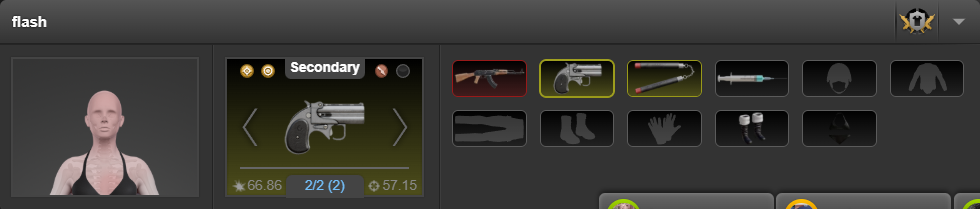
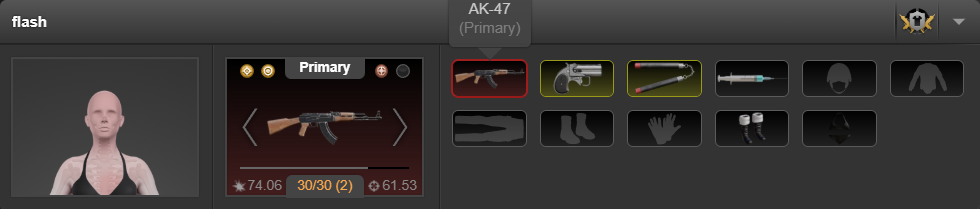

# 武器 Mod 自动恢复实测

2026-10-09，Tabbit 稳定 CLI，用户原有已登录 item.php 标签。没有打开其他浏览器、切换物品分类、刷新整页或使用消耗品。

## 原生机制

读取页面已加载的 loadouts app 与 n_items.js。原生配装资料来自 itemsLoadouts/getEquippedItems，具体武器实例在 currentItems 的 armouryID，Mod 在 currentUpgrades。原生 Mod 可用性资料来自 itemsModsData/getUserUpgrades，包含 upgradeID、attached、armouryID 和兼容的 armoury 列表。实际点击原生 Mod 菜单确认装配使用 GET itemsModsData/reattach，参数为 armouryID、upgradeID、replaceUpgradeID；请求带 X-Requested-With: XMLHttpRequest，并由页面 addRFC 添加 RFC 参数。

实现复用上述已验证端点与公开的 loadouts.actions.getEquippedItemsRequestAction()，不读取或修改 React 私有字段，不建立替代装备栏。

## 登录页面结果

在原页面临时加载安装包中的相同 Quick Items 模块，使用独立内存配置，不改用户持久收藏或缓存。

- 原生按钮路径：Cobra Derringer，实例 9343397352。通过原生菜单临时装入 Thermal Sight 和 100mW Laser；快捷卸下时保存两个 Mod；快捷重装后自动发起两次装配并从服务器核验，Torn 原生详情显示两个 Mod 及其属性。
- 缓存路径：AK-47，实例 13393359294。当前分类为 Secondary，Primary 库存行数量为零。通过原生菜单临时装入同样两个 Mod；快捷卸下并重装后自动恢复。服务器结果和 Torn 原生详情均确认 Thermal Sight、100mW Laser。
- 没有 getSearchList 请求或整页读取，没有自动抢占别的武器的 Mod，没有重试。打开的原生 Mod 菜单可能由 Torn 自身再读取 Mod 列表，和脚本触发的恢复请求一并记录。
- 实测发现原生 Mod 端点要求 AJAX 请求头，已补齐，并加入模拟测试断言。
- Mod 原生按钮在配装刷新后包含完整属性描述，已按实际描述检查，而非只检查短名称。
- 缓存请求期间仍观察到现有 TornTools 扩展报错；装备、Mod 以及原生详情成功更新，未修改其他扩展。

截图已打开并检查：

## 清理与边界

测试前两把武器的 Mod 均为空。测试后用真实原生拆除操作移除临时 Mod，服务器核验主武器实例为 13393359294、副武器实例为 9343397352，currentUpgrades 均为 null。其他装备未操作，选中详情恢复 Cobra Derringer。移除测试入口，恢复用户原控件，保留用户页面并释放标签所有权。

Mod 偏好按实例保存，快捷操作前读取实际当前配装，包括用户手动拆除后的空组合；“记住当前 Mod”也可立即保存。没有后台轮询。每次点击可能增加配装读取；装备恢复还可能增加 Mod 列表读取、最多两次装配、配装核验与原生界面更新。

构建、语法检查与 mods-integration.cjs、items-integration.cjs、toolbox-ui.cjs 通过。模拟测试覆盖两条恢复路径、两槽、实例隔离、关闭开关、装备失败、不兼容、被其他武器占用、第二次装配失败后的部分更新、保存空组合，以及原生请求头。

完整安装包在用户脚本管理器中的持久安装、PDA、双持特殊 Mod 组合未实测。持久使用需安装 1.6.13；本记录不表示已替用户完成安装。
